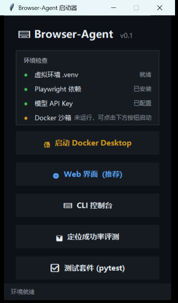

# Browser-Agent：通用浏览器自动化智能体

基于 **OpenManus 架构**（Agent 层次 + 工具集 + 规划流思想）并用 **LangGraph** 重构为分层状态机的自主浏览器 Agent，解决传统 RPA 无法处理的动态网页交互与复杂推理任务（跨平台比价、竞品分析）。

```
Python 3.11+ · LangGraph · Playwright · Qwen-Max/Qwen3-VL (GUI-Plus) · Docker/Daytona · MCP Protocol
```

## 四大核心设计

| # | 设计 | 解决的问题 | 实现位置 |
|---|------|-----------|---------|
| 1 | **多模态双重定位（GUI-Plus 策略）** | 动态网页 DOM 解析不准：图标按钮无文本、canvas 无 DOM、同文本按钮难区分 | `app/browser/locator.py`：DOM 规则匹配 → DOM+LLM 匹配 → 视觉 SoM 选择 → 视觉 bbox 回归，四级降级 |
| 2 | **分层状态机（ReAct 范式）** | 单体 Chain 无法承载长链路任务（>10 步）的拆解与动态调整 | `app/agent/`：LangGraph StateGraph 组装 Planner → Executor ⇄ Tools → Reviewer，支持动态 replan |
| 3 | **安全沙箱双模式** | Agent 生成的 Python 代码可能有害 | `app/sandbox/`：统一 SandboxProvider 接口，Daytona 云沙箱 + 本地 Docker（断网/只读/资源上限/超时），自动降级 |
| 4 | **工具标准化（MCP）** | 工具与 Agent 耦合，接入成本高 | `mcp_servers/` + `app/mcp/registry.py`：文件/搜索/浏览器解耦为独立 Server（stdio 或 streamable-http），config 增删即热插拔 |

## 快速开始

```bash
# 1. 安装依赖
python -m venv .venv
.venv\Scripts\activate          # Windows
pip install -r requirements.txt

# 2. 安装浏览器内核
python -m playwright install chromium

# 3. 配置 LLM（默认阿里云百炼，任何 OpenAI 兼容端点均可）
set DASHSCOPE_API_KEY=sk-xxx      # 默认端点从这里读 key（Linux/Mac: export）
# 不建 config.toml 也能直接跑（回退到 config.example.toml 的默认值）；
# 需要改模型/端点/预设时：copy config.example.toml config.toml 再改

# 4. 启动
launcher.bat                   # 🚀 图形启动器（推荐）：环境自检 + 一键启动
```



启动器功能：

- **环境自检**：虚拟环境 / Playwright / API Key / Docker 四项状态灯（后台线程检测，不卡界面）
- **🐳 启动 Docker Desktop**：只在 Docker 已安装但引擎没运行时出现，点击后启动并等待就绪
- **🌐 Web 界面**：启动/停止 Web 服务（按钮切换），启动后自动打开浏览器
- **⌨ CLI 控制台** / **📊 定位评测** / **✅ 测试套件**：各在新终端窗口运行

命令行等价方式：

```bash
run_web.bat                    # Web 界面（或 .venv\Scripts\python webui.py → http://127.0.0.1:8686）
run.bat                        # CLI 交互（自动用 .venv；注意直接 python main.py 需先激活 venv）
.venv\Scripts\python eval/run_eval.py   # 评测
.venv\Scripts\python -m pytest tests/ --asyncio-mode=auto   # 测试
```

## Web 界面

```bash
run_web.bat                    # 或 .venv\Scripts\python webui.py
```

打开 [http://127.0.0.1:8686](http://127.0.0.1:8686)：

- 左栏输入任务 → 右栏**实时状态机轨迹**（Planner 计划 / Executor 工具调用 / Tools 结果与截图 / Reviewer 判定徽章）
- 计划面板随执行推进显示步骤状态（○ 待执行 / ◐ 进行中 / ● 完成 / ✗ 失败）
- 工具截图直接内嵌展示，点击可放大
- 顶栏**模型下拉框**：即选即切（任务运行中禁用）
- 支持运行中取消任务

**模型切换**：预设声明在 `config.toml [[model_presets]]`（模板默认含 Qwen Plus / Qwen Flash / MiMo Pro 三个）。Web 顶栏下拉切换，或 CLI 中 `model` 查看、`model qwen-plus` 切换。指向其他端点的预设配 `base_url + api_key`（或 `api_key_env` 指定环境变量名）；空字段自动继承 `[llm]` 默认值。

技术：FastAPI + WebSocket 事件流（复用 CLI 的 `run_agent(on_event=...)` 回调，前后端同一套事件协议），单文件前端无构建依赖。

模型说明：默认指向阿里云百炼——`qwen-max`（文本/工具调用，Planner/Executor/Reviewer 共用）+ `qwen3-vl-plus`（GUI-Plus 视觉通道，图片输入 + 结构化输出）。key 按端点自动解析：百炼读 `DASHSCOPE_API_KEY`，小米 MiMo 读 `MIMO_API_KEY`，通用可用 `LLM_API_KEY`——多把 key 共存时不会发错端点。视觉定位对坐标系约定不一致的模型（Qwen3-VL 用 0–1000 网格坐标，MiMo/gui-plus 用像素）会自动探测并换算，无需手动配置。

示例任务：

```
• 打开 eval/cases/duplicate_labels.html，找到"无线耳机 Pro"的价格并点击它的查看价格按钮
• 搜索"Playwright python"，总结 3 个要点写入 notes.md
• 打开两个本地比价页，用沙箱计算差价并生成报告
```

## 定位成功率评测（可复现）

```bash
python eval/run_eval.py            # DOM-only vs GUI-Plus 双模式对比
python eval/run_eval.py --mode dom-only
python eval/run_eval.py --mode gui-plus
```

12 个任务 × 4 个本地场景（`eval/cases/`，离线可复现，不依赖外网）：

| 场景 | 难点 | DOM 通道 | 视觉通道 |
|------|------|---------|---------|
| `icon_toolbar` | 8 个图标按钮，无任何文本/aria 属性 | 规则匹配 0 分，LLM 只能盲猜 | SoM 标注截图后 VLM 按图形识别 |
| `canvas_shapes` | 4 个"按钮"画在 canvas 里，DOM 中无元素 | 无候选，直接失败 | VLM 直接回归 bbox 坐标 |
| `popup_overlay` | 弹窗 + SVG 叉号关闭按钮 | 无文本线索 | 视觉识别叉号位置 |
| `duplicate_labels` | 两个"查看价格"按钮 DOM 完全同文本 | 命中第一个（可能是错的） | 结合页面上下文区分卡片 |

评测判定标准是**点击后的真实页面效果**（`window.__clicked` 是否等于期望值），而非"定位器返回了结果"。报告输出到 `workspace/eval-report-*.md`。

## MCP 工具热插拔

默认以 stdio 子进程拉起 `filesystem` + `search` 两个 MCP server（见 `config.toml [mcp]`）：

```toml
[mcp]
servers = ["filesystem", "search"]   # 删掉一个 = 卸载其全部工具
```

容器化部署（streamable-http）：

```bash
docker compose up -d                 # 拉起 mcp-filesystem / mcp-search
```

```toml
[mcp_servers.search]
url = "http://localhost:8002/mcp"    # 从 stdio 切到容器只需改定义
```

Agent 代码零改动——Executor 只看到统一的工具注册表 `app/mcp/registry.py`。

## 沙箱

`python_execute` 工具的执行策略（`config.toml [sandbox] provider`）：

| provider | 行为 |
|----------|------|
| `auto`（默认） | Daytona（有 API key 时）→ 本地 Docker → 本地子进程（降级时明确警告无隔离）。Docker Desktop 已安装但引擎没开时，会自动把它启动起来并等待就绪 |
| `docker` | 每次执行临时容器：`network=none` + `read_only` + `mem_limit` + 超时 kill |
| `daytona` | daytona-sdk 云沙箱（`pip install daytona-sdk` + `DAYTONA_API_KEY`） |

构建推荐沙箱镜像（预装 pandas/numpy/requests，非 root）：

```bash
docker build -t browser-agent-sandbox .
```

国内网络直连不了 Docker Hub / PyPI 时，用构建参数指向镜像源（不需要改 Docker 全局配置）：

```bash
docker build -t browser-agent-sandbox \
  --build-arg BASE_IMAGE=docker.m.daocloud.io/library/python:3.11-slim \
  --build-arg PIP_INDEX_URL=https://pypi.tuna.tsinghua.edu.cn/simple .
```

隔离项均有测试覆盖（`tests/test_sandbox.py`，Docker 可用时自动执行）：断网、只读根文件系统、内存硬上限（禁用 swap）、超时后容器清理、stdout/stderr 分离。

## 架构

```
                       ┌──────────────────────────────────────────────┐
                       │                LangGraph 状态机               │
                       │                                              │
  用户任务 ──► Planner ─┤ 拆解/重规划                                  │
                       │   │                                          │
                       │   ▼                                          │
                       │ Executor ◄──── 工具结果 ──── Tools            │
                       │   │ ReAct 循环        ▲                       │
                       │   │ 纯文本结论        └── terminate ──► END   │
                       │   ▼                                          │
                       │ Reviewer ── continue ──► 下一阶段             │
                       │   │        └─ replan ──► Planner             │
                       │   └─ finish ──► END                           │
                       └──────────────┬───────────────────────────────┘
                                      │ 统一工具注册表 (registry)
        ┌──────────────┬──────────────┼──────────────┬──────────────┐
        ▼              ▼              ▼              ▼              ▼
   本地工具        MCP: 文件      MCP: 搜索      MCP: 浏览器      沙箱执行
   (浏览器GUI-Plus  (stdio/http)  (stdio/http)   (stdio/http)   (Docker/Daytona)
    双重定位)
```

详见 [docs/architecture.md](docs/architecture.md)。

## 测试

```bash
python -m pytest tests/ --asyncio-mode=auto -v
```

覆盖：DOM 提取（真实 Chromium）、定位规则打分、状态机路由、工作区路径安全、沙箱隔离（Docker 可用时验证断网）。

## 目录结构

```
browser-agent/
├── main.py                  # CLI 入口
├── config.toml              # 配置（LLM/沙箱/MCP/浏览器）
├── app/
│   ├── agent/               # LangGraph 状态机 (planner/executor/reviewer/graph)
│   ├── browser/             # Playwright + DOM 提取 + GUI-Plus 定位器
│   ├── llm/                 # OpenAI 兼容客户端 + 视觉定位 (SoM/grounding)
│   ├── mcp/                 # MCP 客户端 + 工具注册表（热插拔）
│   ├── sandbox/             # Daytona / Docker / local 三种沙箱
│   ├── tools/               # BaseTool + 浏览器/搜索/文件/沙箱工具
│   └── prompt/              # Planner/Executor/Reviewer 提示词
├── mcp_servers/             # 独立 MCP Server（可容器化）
├── eval/                    # 定位成功率评测 + 本地场景
├── tests/                   # pytest
├── Dockerfile               # 沙箱镜像
├── Dockerfile.mcp           # MCP Server 容器镜像
└── docker-compose.yml       # 容器化 MCP 工具服务器
```

## 已知限制

下面两条是大模型能力带来的硬约束，工程上只能加防护，不能根除：

- **视觉定位的准确度有上限**。已做的防护：坐标系自动探测与换算、越界坐标直接拒绝、点击前检查落点（落在空白背景上判为定位失败，而不是盲点）。弱模型下 SoM 模式仍比 bbox 回归更稳，推荐 qwen3-vl-plus 及以上
- **复杂网站上的长链路任务无法保证一次成功**。已做的缓解：每步最多 8 轮工具调用、重规划上限 3 次、同一调用连续 3 次得到相同结果时提示模型换方法

早先的三条限制已经处理掉：

| 原限制 | 现在的行为 |
|--------|-----------|
| DuckDuckGo 搜索被限流 | 多个搜索源按顺序自动切换（`[search] providers`，默认 Bing → DuckDuckGo → 百炼搜索接口），单个搜索源失效不影响搜索 |
| Docker 引擎没启动时沙箱悄悄降级 | Docker Desktop 已安装但未运行时自动启动并等待（`[sandbox] auto_start_docker`），启动器里也有一键启动按钮 |
| 视觉模型给错坐标时照样点击 | 落点校验：视口外或空白背景上的坐标判为定位失败；DOM 目标被遮挡时照常点击，但提示智能体核对效果 |
